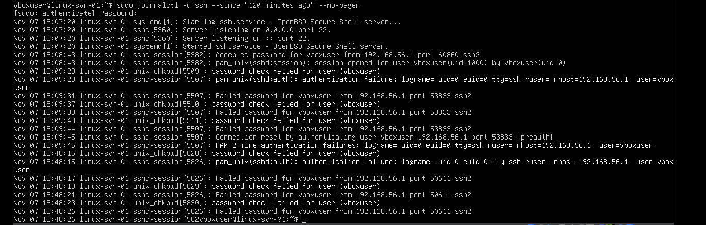
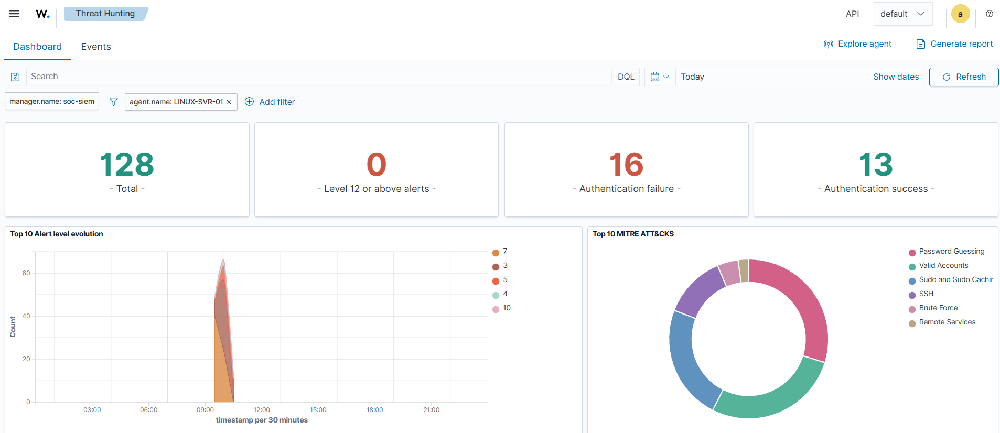
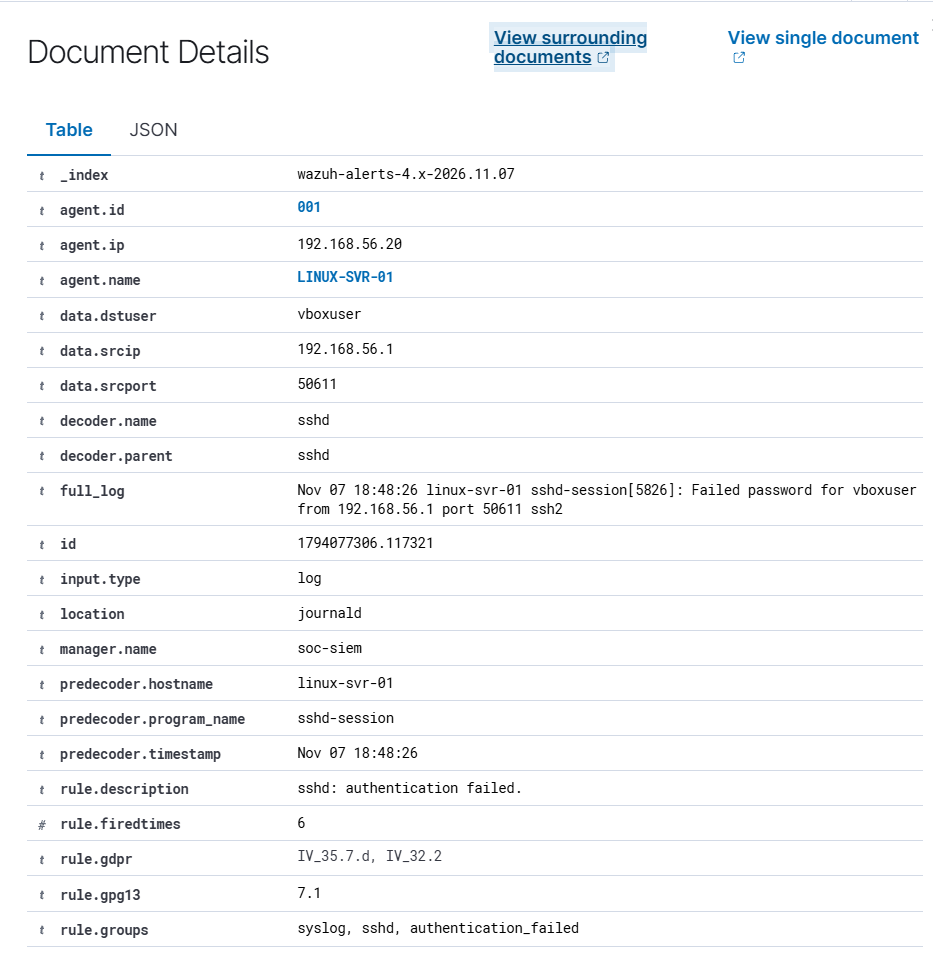
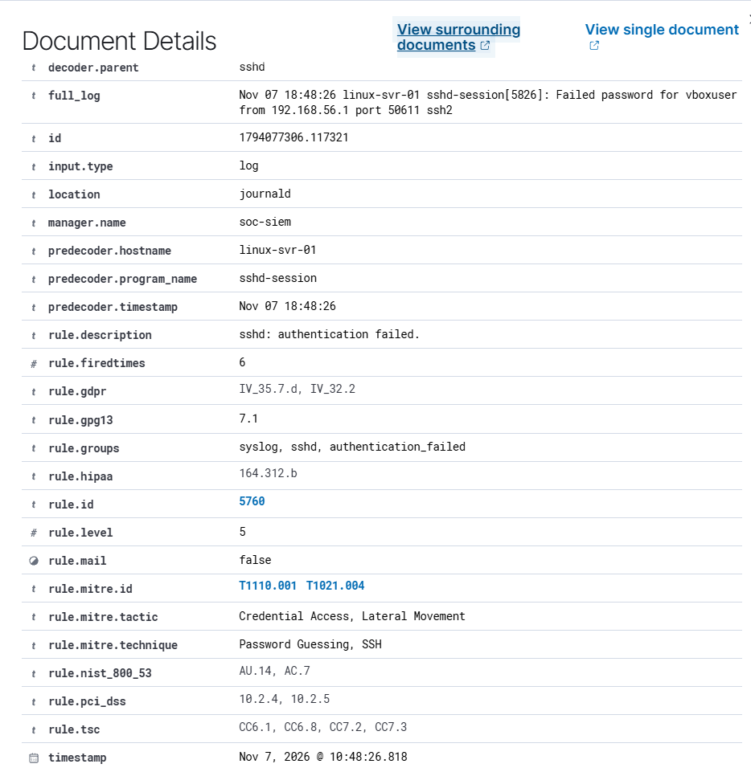

# INC-001 — SSH Authentication Failure Investigation

The following evidence was collected during the authorized SSH authentication simulation.

### Evidence 1 — Linux Authentication Logs

Shows the SSH authentication failures recorded by the Linux endpoint.

### Evidence 2 — Wazuh Threat Hunting Dashboard

Shows centralized security monitoring and authentication alerts associated with the Linux endpoint.

### Evidence 3 — Wazuh Detection Rule 5760

Shows the detected SSH authentication failure, Wazuh Rule 5760, severity level 5, and MITRE ATT&CK mapping.

**Evidence directory:** [INC-001 Evidence](../evidence/INC-001/)
